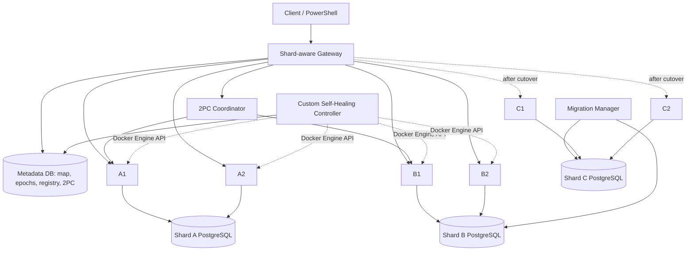

# Distributed Banking Platform — Live A/B → C Sharding

**Python 3.12 · FastAPI · PostgreSQL 16 · Docker Compose · Windows PowerShell**

A containerized, shard-aware banking system with real PostgreSQL **two-phase commit (2PC)**, concurrent banking operations, durable crash recovery, **online migration from Shard B to a newly added Shard C**, and a custom self-healing replica controller.

> **Start state:** only **A and B** run. Shard C is added **while the banking service remains online**, then accounts `A1501–A2000` are migrated to C. **Do not start the `expansion` profile during the initial deployment.**
>
> This is an educational, single-host distributed-systems implementation, **not** a production banking system. Use a trusted local Docker environment only.

## Contents

1. [Features and architecture](#1-features-and-architecture)
2. [Prerequisites](#2-prerequisites)
3. [Clone and configure](#3-clone-and-configure)
4. [Start with exactly two shards](#4-start-with-exactly-two-shards)
5. [Verify the initial A/B deployment](#5-verify-the-initial-ab-deployment)
6. [Run the seven required experiments](#6-run-the-seven-required-experiments)
7. [Bonus I — add C, copy data, and perform cutover](#7-bonus-i--add-c-copy-data-and-perform-cutover)
8. [Bonus I — four isolated migration-crash tests](#8-bonus-i--four-isolated-migration-crash-tests)
9. [Bonus II — autonomous replica self-healing](#9-bonus-ii--autonomous-replica-self-healing)
10. [Automated tests and CI](#10-automated-tests-and-ci)
11. [Docker Hub images](#11-docker-hub-images)
12. [Troubleshooting](#12-troubleshooting)
13. [Cleanup, safety, and limitations](#13-cleanup-safety-and-limitations)
14. [Repository layout and supporting documentation](#14-repository-layout-and-supporting-documentation)

## 1. Features and architecture

### Service overview



*The C services and Migration Manager appear only when the `expansion` profile is started. The diagram is conceptual; the Coordinator discovers the current participant replicas dynamically.*

| Component | Responsibility |
| --- | --- |
| Gateway | Account-to-shard routing, healthy-replica selection, and public HTTP API |
| A1/A2, B1/B2, later C1/C2 | Stateless application replicas; each pair shares its own shard's PostgreSQL database |
| Metadata DB | Shard map, routing epoch, replica registry, 2PC decisions, migration phases and checkpoints |
| Coordinator | Durable 2PC voting, `PREPARE TRANSACTION`, final decisions, acknowledgements and recovery |
| Migration Manager | Consistent snapshot, change journal replay, fencing, and durable ownership cutover |
| Self-Healing Controller | Detects failed replica slots; creates and adopts Docker containers with persisted generations |
| Schema Migrator | One-shot database migrations and initial A/B account seed |

**Initial routing** (epoch 1):

| Account range | Owner | Replicas |
| --- | --- | --- |
| `A0001–A1000` | A | A1, A2 |
| `A1001–A2000` | B | B1, B2 |
| `A1501–A2000` | **still B** | **C does not exist yet** |

**After the one-way B → C cutover** (the migrated range advances to a new epoch):

| Account range | Owner | Replicas |
| --- | --- | --- |
| `A0001–A1000` | A | A1, A2 |
| `A1001–A1500` | B | B1, B2 |
| `A1501–A2000` | C | C1, C2 |

### Main design decisions

- **Range sharding:** The Gateway resolves each account against the durable shard map.
- **Application replication, not database replication:** Each shard has two application replicas and one PostgreSQL database.
- **Concurrency control:** Row-level `SELECT ... FOR UPDATE` locking, SQL transactions, `NUMERIC(20,2)` balances, and deduplicated client request IDs.
- **Real 2PC:** Separate PostgreSQL shards run `PREPARE TRANSACTION` followed by `COMMIT PREPARED` or `ROLLBACK PREPARED`; Coordinator votes and decisions survive process restarts.
- **Honest outcomes:** A timeout is `PENDING`/`UNKNOWN`, not an automatic failure. Always check the *same request ID* before attempting a retry.
- **Online resharding:** A consistent B snapshot, transactional application change journal, version-checked/idempotent C replay, final synchronization, fencing and epoch-based ownership switch.
- **Application-managed recovery:** The Self-Healing Controller uses the Docker Engine API and a persistent replica registry; no Kubernetes, Swarm or automatic Docker restart policy.

## 2. Prerequisites

For the **Windows instructions in this README**:

- Windows 10/11 with **Docker Desktop running Linux containers** (WSL 2 backend recommended).
- Docker Engine, **Docker Compose v2** (`docker compose`, not `docker-compose`).
- **PowerShell** (PowerShell 7 recommended; Windows PowerShell 5.1 also supports the commands below).
- **Git** (only needed to clone or publish the repository).
- Network access to download base images and Python dependencies for the first build.
- Sufficient Docker resources for several FastAPI containers plus **three PostgreSQL instances** when C is added. The four isolated crash labs create additional databases and containers, so stop finished labs before starting another one.

Verify your tools:

```powershell
docker version
docker compose version
git --version
```

All PowerShell blocks assume that you run them **in the folder containing `compose.yaml`**, unless stated otherwise. Bash, CMD and PowerShell syntax are not interchangeable.

## 3. Clone and configure

```powershell
git clone https://github.com/Zolanvar74/distributed-banking.git
cd distributed-banking

Copy-Item .env.example .env
```

Edit `.env` using a text editor and choose development-only secret values. The file must contain at least:

```dotenv
POSTGRES_PASSWORD=CHANGE_THIS_FOR_YOUR_LOCAL_RUN
GATEWAY_PORT=8221
TWO_PC_TOKEN=CHANGE_THIS_TO_A_LONG_RANDOM_LOCAL_TOKEN
```

The supplied `.env.example` may default to port `8000`; this README uses **port `8221`**. Either set `GATEWAY_PORT=8221` in `.env` as above or set the matching PowerShell environment variable.

In the same PowerShell session, set the runtime variables used by the demonstration and fault-injection steps:

```powershell
$env:COMPOSE_PROJECT_NAME = 'banking-video-ab'
$env:GATEWAY_PORT = '8221'
$env:STAGE07_ENABLE_FAULTS = '0'
$env:STAGE09_ENABLE_FAULTS = '0'
$env:STAGE14_ENABLE_FAULTS = '0'
$base = 'http://localhost:8221'
$ErrorActionPreference = 'Stop'

if (-not (Test-Path .\compose.yaml)) { throw 'Run PowerShell in the repository root.' }
docker compose config --quiet
```

**Never commit `.env`** or real secrets. `.env.example` is safe to publish when it contains only placeholders. The Compose project name is used by the Docker network, labels and custom self-healing controller; keep it consistent within one deployment.

> **Existing deployment?** `docker compose up` reuses named database volumes. If this project has already completed cutover, restarting it **will not** reset ownership to A/B. For a clean initial demo, use a fresh Compose project with unused volumes; see [cleanup](#13-cleanup-safety-and-limitations). Never run the A/B seed or cutover on a database whose ownership map has already changed.

## 4. Start with exactly two shards

### 4.1 Build and start

```powershell
docker compose build

docker compose up -d `
  metadata-db shard-a-db shard-b-db schema-migrator `
  shard-a-1 shard-a-2 shard-b-1 shard-b-2 `
  coordinator gateway self-healing

docker compose ps -a
```

**Do not include `--profile expansion` yet.** The one-shot `schema-migrator` applies the A/B schemas and creates all **2,000** demo accounts (1,000 on A and 1,000 on B). Its container may show `Exited (0)` after successfully finishing; that is normal. The other services should be up/healthy.

Inspect startup output:

```powershell
docker compose logs --tail=80 schema-migrator
docker compose logs --tail=50 gateway coordinator self-healing
Invoke-RestMethod "$base/health" | ConvertTo-Json -Depth 6
```

### 4.2 Verify initial account data

```powershell
docker compose run --rm --no-deps schema-migrator `
  python -m scripts.demo_verify_ab
```

Expected success marker:

```text
VIDEO INITIAL A/B: ALL CHECKS PASSED
```

Verify the actual database contents and routing:

```powershell
Invoke-RestMethod "$base/debug/shard-map" | ConvertTo-Json -Depth 8

'A0001','A1000','A1001','A1500','A2000' | ForEach-Object {
    Invoke-RestMethod "$base/debug/route/$_"
} | Format-Table

docker compose exec -T shard-a-db psql -U banking -d shard_a `
  -c 'SELECT COUNT(*), MIN(account_id), MAX(account_id) FROM accounts;'

docker compose exec -T shard-b-db psql -U banking -d shard_b `
  -c 'SELECT COUNT(*), MIN(account_id), MAX(account_id) FROM accounts;'
```

**Checkpoint:** A owns `A0001–A1000`, B owns `A1001–A2000`, both have 1,000 accounts, and there are **no C containers** in the initial deployment.

## 5. Verify the initial A/B deployment

Run static/contract tests and read-only preflight checks **before injecting failures**:

```powershell
# Python unit and contract tests (executed using the existing app image)
docker compose run --rm --no-deps schema-migrator `
  python -m pytest -q tests

# Database foundation, routing, and healthy-replica preflight
docker compose run --rm --no-deps schema-migrator `
  python -m scripts.verify_stage02

docker compose run --rm --no-deps schema-migrator `
  python -m scripts.verify_stage03

docker compose run --rm --no-deps schema-migrator `
  python -m scripts.verify_stage04 --scenario=normal

docker compose run --rm --no-deps schema-migrator `
  python -m scripts.verify_stage09 --scenario=preflight
```

The stage scripts fail with a nonzero exit code when their assertions fail. **A printed success marker is useful, but the concrete API, PostgreSQL and container results in the sections below are the evidence.**

## 6. Run the seven required experiments

Perform these in **assignment order**, using the initial A/B state. Some commands **change balances, stop containers, or intentionally crash a service**. The comprehensive, copy-ready script is [`docs/ASSIGNMENT_ORDER_TESTS_PS.txt`](docs/ASSIGNMENT_ORDER_TESTS_PS.txt). **Copy the numbered blocks from that file into the same PowerShell session in order; do not execute the entire script blindly.** The file also includes `05B` (explicit final ABORT verification), Bonus I, and Bonus II.

### Experiment 1 — Shard distribution and correct routing

Run the SQL and `/debug/route` checks from [§4.2](#42-verify-initial-account-data). Also inspect the active map:

```powershell
docker compose exec -T metadata-db psql -U banking -d metadata -c `
  'SELECT range_start,range_end,shard_id,epoch FROM shard_map WHERE active=true ORDER BY range_start;'
```

**Pass condition:** no overlapping active owners; 1,000 correct accounts per database; requests at the `A1000`/`A1001` boundary route to A/B respectively.

### Experiment 2 — Healthy-replica Round Robin

```powershell
1..16 | ForEach-Object {
    (Invoke-RestMethod "$base/accounts/A0500/balance").served_by
} | Group-Object | Format-Table Name,Count

1..16 | ForEach-Object {
    (Invoke-RestMethod "$base/accounts/A1500/balance").served_by
} | Group-Object | Format-Table Name,Count

Invoke-RestMethod "$base/debug/replicas/A" | ConvertTo-Json -Depth 5
Invoke-RestMethod "$base/debug/replicas/B" | ConvertTo-Json -Depth 5
```

**Pass condition:** responses are served by healthy replicas belonging to the correct shard; both A1/A2 and B1/B2 participate while healthy. Counts need not be perfectly 8/8.

### Experiment 3 — Concurrent local deposits and withdrawals

First check basic local ACID handling:

```powershell
docker compose run --rm --no-deps schema-migrator `
  python -m scripts.verify_stage05
```

Then send **eight deposits and eight withdrawals of `0.01` simultaneously** to `A0500`:

```powershell
$before = [decimal](Invoke-RestMethod "$base/accounts/A0500/balance").balance
$jobs = @(1..16 | ForEach-Object {
    $op = if ($_ -le 8) { 'deposit' } else { 'withdraw' }
    Start-Job -ArgumentList $base,$op -ScriptBlock {
        param($url,$operation)
        $rid = [guid]::NewGuid().ToString('N')
        Invoke-RestMethod "$url/accounts/A0500/$operation" `
          -Method Post -ContentType 'application/json' `
          -Body (@{ amount='0.01'; request_id=$rid } | ConvertTo-Json)
    }
})
$jobs | Wait-Job | Out-Null
$replies = @($jobs | Receive-Job -ErrorAction Stop)
$jobs | Remove-Job
$replies | Group-Object served_by | Format-Table Name,Count
$after = [decimal](Invoke-RestMethod "$base/accounts/A0500/balance").balance
"BEFORE=$before AFTER=$after SUCCESSFUL=$(@($replies | Where-Object status -eq 'COMMITTED').Count)"
if ($replies.Count -ne 16 -or $after -ne $before) { throw 'Concurrency check failed' }
```

**Pass condition:** all 16 operations commit; final balance equals initial balance (net change `0.00`); no lost update is observed in this test.

### Experiment 4 — Replica outage and failover

Send read traffic while deliberately stopping **A1**. The custom controller should replace its failed logical slot:

```powershell
$traffic = Start-Job -ArgumentList $base -ScriptBlock {
    param($url)
    1..45 | ForEach-Object {
        try { (Invoke-RestMethod "$url/accounts/A0500/balance").served_by }
        catch { 'UNAVAILABLE' }
        Start-Sleep -Milliseconds 250
    }
}

$a1 = @(docker ps -q `
    --filter 'label=banking.project=banking-video-ab' `
    --filter 'label=banking.shard=A' `
    --filter 'label=banking.slot=1' `
    --filter 'status=running')
if ($a1.Count -ne 1) { throw 'Expected one running A1 container' }
docker stop $a1[0]
$traffic | Wait-Job | Out-Null
$traffic | Receive-Job | Group-Object | Format-Table Name,Count
$traffic | Remove-Job

docker compose logs --tail=60 self-healing
Invoke-RestMethod "$base/debug/replicas/A" | ConvertTo-Json -Depth 5
```

Inspect the durable replica generation and registration:

```powershell
docker compose exec -T metadata-db psql -U banking -d metadata -c `
  "SELECT replica_id,generation,lifecycle,hostname FROM replica_registry WHERE shard_id='A' ORDER BY slot;"
```

**Pass condition:** A2 continues to serve traffic during A1's absence; the custom controller creates a healthy replacement A1 with a **higher generation**. Transient failed requests at the moment of disruption must be reported, not hidden.

> **Important:** After custom healing, an original Compose-managed replica may be a *stale generation*. Do not blindly `docker compose start shard-a-1`; the controller owns replacement and reconciliation. For later checks, discover healthy replicas from the metadata registry rather than assuming original container names.

### Experiment 5 — Local transfer and genuine cross-shard 2PC

Local transfer within A (`A0001 → A0500`):

```powershell
$localId = 'local-' + [guid]::NewGuid().ToString('N')
Invoke-RestMethod "$base/transfers" -Method Post -ContentType 'application/json' -Body `
  (@{ from_account='A0001'; to_account='A0500'; amount='1.00'; request_id=$localId } | ConvertTo-Json)
```

This changes real data. If you need to return balances to the starting state, perform a **new** transfer in the opposite direction with a **new request ID**—never edit balances directly in SQL.

Cross-shard transfer (`A0500 → A1500`):

```powershell
$ridAB = 'ab-' + [guid]::NewGuid().ToString('N')
$bodyAB = @{ from_account='A0500'; to_account='A1500'; amount='1.00'; request_id=$ridAB } | ConvertTo-Json
try {
    Invoke-RestMethod "$base/transfers" -Method Post -ContentType 'application/json' -Body $bodyAB
} catch {
    "Outcome not yet confirmed; check request ID $ridAB"
}

# Always query this SAME request ID, never create another one for an uncertain retry.
Invoke-RestMethod "$base/transfers/requests/$ridAB" | ConvertTo-Json -Depth 8
```

Inspect the **durable** 2PC record and prepared transactions:

```powershell
docker compose exec -T metadata-db psql -U banking -d metadata -c `
  "SELECT t.tx_id,t.state,t.decision,p.shard_id,p.vote,p.completion_ack FROM transactions t JOIN transaction_participants p ON p.tx_id=t.tx_id WHERE t.client_request_id='$ridAB' ORDER BY p.shard_id;"

docker compose exec -T shard-a-db psql -U banking -d shard_a -c `
  'SELECT gid,prepared FROM pg_prepared_xacts WHERE database=current_database();'

docker compose exec -T shard-b-db psql -U banking -d shard_b -c `
  'SELECT gid,prepared FROM pg_prepared_xacts WHERE database=current_database();'
```

**Expected successful 2PC decision:** `COMPLETED / COMMIT`, both A and B voted `YES`, and both acknowledged the final decision. A completed transfer generally leaves **no unresolved prepared transaction**. A `YES` vote is **not** itself a commit.

**Test idempotency** by posting the exact `$bodyAB` again. The same `tx_id` should be returned and money must **not** move a second time.

#### Explicit ABORT verification (Experiment 5B)

Request an amount greater than the B account balance for a B → A transfer:

```powershell
$bBefore = [decimal](Invoke-RestMethod "$base/accounts/A1500/balance").balance
$aBefore = [decimal](Invoke-RestMethod "$base/accounts/A0500/balance").balance
$tooMuch = ($bBefore + 100).ToString('0.00',[System.Globalization.CultureInfo]::InvariantCulture)
$abortId = 'abort-' + [guid]::NewGuid().ToString('N')
$abortBody = @{ from_account='A1500'; to_account='A0500'; amount=$tooMuch; request_id=$abortId } | ConvertTo-Json

# HTTP 409 is EXPECTED for a confirmed business-level abort.
try {
    Invoke-RestMethod "$base/transfers" -Method Post `
      -ContentType 'application/json' -Body $abortBody | ConvertTo-Json
} catch {
    if ([int]$_.Exception.Response.StatusCode -ne 409) { throw }
    "EXPECTED HTTP 409 for $abortId"
}

# curl.exe prints the final HTTP status/body without turning HTTP 409 into an exception.
& curl.exe -sS -i "$base/transfers/requests/$abortId"

docker compose exec -T metadata-db psql -U banking -d metadata -c `
  "SELECT t.client_request_id,t.state,t.decision,p.shard_id,p.vote,p.completion_ack FROM transactions t JOIN transaction_participants p ON p.tx_id=t.tx_id WHERE t.client_request_id='$abortId' ORDER BY p.shard_id;"

$aAfter = [decimal](Invoke-RestMethod "$base/accounts/A0500/balance").balance
$bAfter = [decimal](Invoke-RestMethod "$base/accounts/A1500/balance").balance
if ($aAfter -ne $aBefore -or $bAfter -ne $bBefore) { throw 'ABORT changed money!' }
```

**Expected:** final `ABORT`, state `COMPLETED`, B vote `NO`, ACKs from both shards, and no balance change for that failed transaction. The status endpoint may return HTTP **409**, which must not be confused with an unresolved coordinator decision. A later successful *compensating transfer* is a **different transaction** with its own Request ID.

### Experiment 6 — Coordinator crash after a durable COMMIT decision

This is intentionally **destructive to the Coordinator process**, not to the database. It proves that an already-persisted COMMIT decision is recovered after restart. It may leave one shard temporarily in PostgreSQL's prepared state.

```powershell
$env:STAGE07_ENABLE_FAULTS = '1'
docker compose up -d --no-deps --force-recreate coordinator
$crashRequest = 'stage07-crash-' + [guid]::NewGuid().ToString('N')

docker compose run --rm --no-deps schema-migrator `
  python -m scripts.verify_stage07 --scenario=arm --request-id $crashRequest

try {
    Invoke-RestMethod "$base/transfers" -Method Post -ContentType 'application/json' -Body `
      (@{ from_account='A0500'; to_account='A1500'; amount='1.00'; request_id=$crashRequest } | ConvertTo-Json)
} catch { "EXPECTED coordinator interruption for $crashRequest" }

docker compose ps -a coordinator
Invoke-RestMethod "$base/transfers/requests/$crashRequest" | ConvertTo-Json -Depth 8

docker compose exec -T shard-b-db psql -U banking -d shard_b -c `
  'SELECT gid,prepared FROM pg_prepared_xacts WHERE database=current_database();'

docker compose run --rm --no-deps schema-migrator `
  python -m scripts.verify_stage07 --scenario=crashed --request-id $crashRequest
```

The fault is injected **after the first participant's durable COMMIT acknowledgement**, leaving the other participant to be resolved. Confirm the intermediate state **before restarting** the Coordinator.

Restart **the existing stopped container directly** (avoids Compose waiting for the one-shot migrator):

```powershell
$coordinatorContainer = docker compose ps -a -q coordinator
if (-not $coordinatorContainer) { throw 'Coordinator container not found' }
docker start $coordinatorContainer

docker compose run --rm --no-deps schema-migrator `
  python -m scripts.verify_stage07 --scenario=recovered --request-id $crashRequest

Invoke-RestMethod "$base/transfers/requests/$crashRequest" | ConvertTo-Json -Depth 8

docker compose run --rm --no-deps schema-migrator `
  python -m scripts.verify_stage07 --scenario=cleanup --request-id $crashRequest

$env:STAGE07_ENABLE_FAULTS = '0'
docker compose up -d --no-deps --force-recreate coordinator
```

**Pass condition:** the original request is eventually `COMMITTED` with both ACKs; no stranded 2PC prepared transactions remain. **Do not** reset databases, force an ABORT, or resend the uncertain transfer using a fresh Request ID.

### Experiment 7 — Concurrent overlapping cross-shard transfers

Use the complete parallel-request block **07** in the companion PowerShell runbook. It submits **four simultaneous `A0500 → A1500` transfers** with independent Request IDs, waits for the final outcome of each, and checks that A decreases by `4.00`, B increases by `4.00`, and the **combined balance is unchanged**. The test concludes with a separately identified compensating transfer.

For additional built-in transaction integration checks, use:

```powershell
docker compose run --rm --no-deps schema-migrator `
  python -m scripts.verify_stage06
```

> The stage-specific scripts can create real transactions. Run them against a test/demo database; resolve uncertain Request IDs before repeating a failed scenario.

## 7. Bonus I — add C, copy data, and perform cutover

**Required order:** add infrastructure → snapshot → online change capture and replay → preflight → **one-way cutover** → verify new ownership and 2PC. Never perform cutover before the copy/replay phase is ready.

### 7.1 Start Shard C without stopping A/B

```powershell
# A/B must already be running, with the original A/B owner map.
Invoke-RestMethod "$base/debug/shard-map" | ConvertTo-Json -Depth 8

docker compose --profile expansion up -d shard-c-db
```

Wait for **TCP PostgreSQL readiness**, not merely for Docker's container-start event:

```powershell
$cReady = $false
for ($i = 0; $i -lt 60; $i++) {
    docker compose --profile expansion exec -T shard-c-db `
      pg_isready -h 127.0.0.1 -p 5432 -U banking -d shard_c
    if ($LASTEXITCODE -eq 0) { $cReady = $true; break }
    Start-Sleep -Seconds 2
}
if (-not $cReady) { throw 'Shard C PostgreSQL TCP is not ready' }
```

Now apply **C-only** database migrations, then start its application replicas and the Migration Manager:

```powershell
docker compose --profile expansion run --rm --no-deps schema-migrator `
  python -m scripts.demo_migrate --targets shard-c

docker compose --profile expansion up -d --no-deps `
  shard-c-1 shard-c-2 migration-manager

docker compose --profile expansion run --rm --no-deps schema-migrator `
  python -m scripts.demo_enable_c

Invoke-RestMethod "$base/debug/replicas/C" | ConvertTo-Json -Depth 6
Invoke-RestMethod "$base/debug/route/A2000" | ConvertTo-Json -Depth 6
```

**Checkpoint:** both C replicas are healthy and its database is initialized, **but A2000 still routes to B**. Simply starting C does **not** change the owner map.

### 7.2 Consistent snapshot and shadow copy

```powershell
docker compose run --rm --no-deps schema-migrator `
  python -m scripts.verify_stage11 --scenario=preflight

docker compose run --rm --no-deps schema-migrator `
  python -m scripts.verify_stage11 --scenario=bootstrap
```

The source B snapshot includes balances and per-account versions for `A1501–A2000`. C receives a **non-authoritative shadow copy**, initially in `migration_target_accounts`. The source snapshot and job checkpoints are durable.

```powershell
docker compose exec -T shard-b-db psql -U banking -d shard_b -c `
  "SELECT account_id,balance,version FROM accounts WHERE account_id='A2000';"

docker compose exec -T shard-c-db psql -U banking -d shard_c -c `
  "SELECT account_id,balance,version FROM migration_target_accounts WHERE account_id='A2000';"
```

### 7.3 Online change capture, replay, and idempotency

**B remains authoritative** during the copy. Normal deposits, withdrawals and transfers continue to update B. Banking writes simultaneously append versioned records to the transactionally maintained **application change journal** (`account_change_groups`, `account_changes`). This is **not** PostgreSQL WAL logical replication.

```powershell
# Run real online writes and verify replay to C.
docker compose run --rm --no-deps schema-migrator `
  python -m scripts.verify_stage11 --scenario=online

# Inspect source journal and current balances/versions.
docker compose exec -T shard-b-db psql -U banking -d shard_b -c `
  "SELECT account_id,version,before_balance,after_balance FROM account_changes WHERE account_id='A2000' ORDER BY version DESC LIMIT 10;"

docker compose exec -T shard-b-db psql -U banking -d shard_b -c `
  "SELECT account_id,balance,version FROM accounts WHERE account_id='A2000';"

docker compose exec -T shard-c-db psql -U banking -d shard_c -c `
  "SELECT account_id,balance,version FROM migration_target_accounts WHERE account_id='A2000';"
```

**Pass condition:** target balances and versions catch up with B; duplicate replay cannot apply the same change group twice. `migration_target_applied_groups` records applied groups, and source B continues to own the range until cutover.

### 7.4 One-way atomic cutover: B → C

**Warning: this changes durable routing ownership. Do not repeat `--scenario=cutover` after success.** The Manager first prevents new conflicting 2PC work, closes the old source's write fence, resolves outstanding transactions, performs final replay, promotes the C copy, updates the routing epoch/map, and opens C's write fence. Those actions are **ordered** and protected by durable migration phases.

```powershell
docker compose run --rm --no-deps schema-migrator `
  python -m scripts.verify_stage12 --scenario=preflight

# ONE-TIME ownership change:
docker compose run --rm --no-deps schema-migrator `
  python -m scripts.verify_stage12 --scenario=cutover

Invoke-RestMethod "$base/debug/shard-map" | ConvertTo-Json -Depth 8
Invoke-RestMethod "$base/debug/route/A1500" | ConvertTo-Json -Depth 5
Invoke-RestMethod "$base/debug/route/A2000" | ConvertTo-Json -Depth 5
```

Inspect actual database-side write fencing:

```powershell
docker compose exec -T shard-b-db psql -U banking -d shard_b -c `
  'SELECT range_start,range_end,epoch,writable FROM ownership_fences ORDER BY range_start;'

docker compose exec -T shard-c-db psql -U banking -d shard_c -c `
  'SELECT range_start,range_end,epoch,writable FROM ownership_fences ORDER BY range_start;'
```

**Expected:** B retains `A1001–A1500`; C owns `A1501–A2000` with a newer epoch. B's migrated range is **not writable** and C's corresponding range **is writable**. Direct old-epoch writes are rejected (HTTP 409) even if they bypass the Gateway.

### 7.5 Preserve old request-id idempotency and verify post-cutover 2PC

```powershell
# One-time/backfill of pre-cutover B request history into Metadata:
docker compose run --rm --no-deps schema-migrator `
  python -m scripts.backfill_stage13

# Run post-cutover preflight and focused correctness checks.
docker compose run --rm --no-deps schema-migrator `
  python -m scripts.verify_stage13 --scenario=preflight

docker compose run --rm --no-deps schema-migrator `
  python -m scripts.verify_stage12 --scenario=stale

docker compose run --rm --no-deps schema-migrator `
  python -m scripts.verify_stage13 --scenario=legacy

docker compose run --rm --no-deps schema-migrator `
  python -m scripts.verify_stage13 --scenario=cross

docker compose run --rm --no-deps schema-migrator `
  python -m scripts.verify_stage13 --scenario=overlap

docker compose run --rm --no-deps schema-migrator `
  python -m scripts.verify_stage13 --scenario=stale2pc
```

These tests check that **old B Request IDs** cannot execute again on C, A ↔ C transfers use real 2PC after migration, stale direct 2PC PREPARE is rejected, and overlapping transfers conserve money. Some tests issue **real banking operations** and may fail safely if an earlier request remains unresolved.

### 7.6 Final read-only audit

```powershell
docker compose run --rm --no-deps schema-migrator `
  python -m scripts.verify_stage14 --scenario=postcutover --json
```

Expected marker:

```text
STAGE 14 READ-ONLY POST-CUTOVER AUDIT: ALL CHECKS PASSED
```

The audit checks the authoritative shard map, epoch, B/C fences, current account ownership, unresolved migration-related 2PC participants, prepared transactions, healthy replicas, and Gateway routing. **A passing audit does not replace the actual concurrency or crash tests.**

## 8. Bonus I — four isolated migration-crash tests

Do **not** run these crash injections on the main demo's already-migrated databases. Each test needs a **fresh Compose project, clean named volumes, and a free Gateway port**. The companion runbook contains the fully guarded `Invoke-Stage14Lab` function: [`docs/ASSIGNMENT_ORDER_TESTS_PS.txt`](docs/ASSIGNMENT_ORDER_TESTS_PS.txt), **block 14**, followed by blocks **15–18**.

The helper creates a unique project name for each attempt, starts new A/B/C databases, arms the named fault, checks durable `FIRED` evidence and the actual failed Manager state, restarts only the Manager, and verifies recovery. The helper restores your main project's PowerShell variables afterwards. **Do not proceed after any `LAB NOT COMPLETED` error.**

Copy/paste **block 14** (the function definitions) into the current PowerShell session **once**. Then execute one at a time:

```powershell
Invoke-Stage14Lab -Point SNAPSHOT_PERSISTED -Port 8391
Invoke-Stage14Lab -Point DELTA_GROUP_APPLIED -Port 8392
Invoke-Stage14Lab -Point FENCING_GATE_CLOSED -Port 8393
Invoke-Stage14Lab -Point MAP_ACTIVATED -Port 8394
```

| Crash point | Failure moment | Key recovery requirement |
| --- | --- | --- |
| `SNAPSHOT_PERSISTED` | Source snapshot is durably stored; Manager exits before moving on | Recover existing snapshot instead of generating inconsistent duplicate state |
| `DELTA_GROUP_APPLIED` | Change group was applied on C before Manager checkpoint advanced | Replay must be idempotent; no duplicate money movement |
| `FENCING_GATE_CLOSED` | New-transaction fencing gate in Metadata closes | Recovery must finish in a fail-closed manner; do not allow conflicting new work |
| `MAP_ACTIVATED` | Metadata owner map has switched to C; final activation is incomplete | Preserve the durable C decision, keep B unwritable, and finish enabling C |

**Important distinction:** `FENCING_GATE_CLOSED` is the transaction-admission gate, **not necessarily the later database-side B write fence**. The migration verifier checks the precise state for each fault point.

For each test, the expected evidence sequence is: **`ARMED` → `FIRED` / Manager crash → `CRASHED ... PASSED` → `RECOVERED ... PASSED`**. Successful completion stops that lab's containers while preserving its data for inspection.

If a lab fails, inspect only its uniquely printed project, for example:

```powershell
# Replace the example name with the exact failed lab project reported on screen.
docker compose -p banking-v-snapshot-EXAMPLE --profile expansion ps -a
docker compose -p banking-v-snapshot-EXAMPLE --profile expansion logs --tail=100 migration-manager
```

Do not reuse a failed lab database, change the active Compose project implicitly, or run cutover against the main project while investigating a crash.

## 9. Bonus II — autonomous replica self-healing

### 9.1 Normal self-healing

The controller watches replica registry/health, maintains each shard's desired replica count, and uses the **Docker Engine API** to create a higher-generation replacement for a failed slot. Healthy slots remain untouched. The Gateway discovers the replacement dynamically. The Docker socket is powerful: **only run this controller on a trusted local machine.**

The A1 outage in [Experiment 4](#experiment-4--replica-outage-and-failover) demonstrates this functionality. Verify the controller's preflight and generation state:

```powershell
docker compose run --rm --no-deps schema-migrator `
  python -m scripts.verify_stage09 --scenario=preflight

docker compose exec -T metadata-db psql -U banking -d metadata -c `
  'SELECT replica_id,shard_id,generation,lifecycle,hostname FROM replica_registry ORDER BY shard_id,slot;'
```

### 9.2 Controller crash *during* replacement

This scenario crashes the **controller itself**, after it created the next-generation B2 container but before replacement is fully reconciled. Use **the main project after the other banking tests**, with all fault flags off except this one:

```powershell
$env:STAGE09_ENABLE_FAULTS = '1'
docker compose up -d --no-deps --force-recreate self-healing

$trial = [guid]::NewGuid().ToString()
docker compose run --rm --no-deps schema-migrator `
  python -m scripts.verify_stage09 --scenario=preflight

docker compose run --rm --no-deps schema-migrator `
  python -m scripts.verify_stage09 --scenario=arm --replica=B2 `
  --point=AFTER_CREATE --trial-id=$trial

$b2 = @(docker ps -q `
  --filter 'label=banking.project=banking-video-ab' `
  --filter 'label=banking.shard=B' `
  --filter 'label=banking.slot=2' `
  --filter 'status=running')
if ($b2.Count -ne 1) { throw 'Expected one running B2 container' }
docker stop $b2[0]

docker compose run --rm --no-deps schema-migrator `
  python -m scripts.verify_stage09 --scenario=crashed --trial-id=$trial

docker compose ps -a self-healing
```

Restart the **existing** stopped controller, then prove it adopted/reconciled a single replacement:

```powershell
$controllerContainer = docker compose ps -a -q self-healing
if (-not $controllerContainer) { throw 'Self-healing controller container not found' }
docker start $controllerContainer

docker compose run --rm --no-deps schema-migrator `
  python -m scripts.verify_stage09 --scenario=recovered --trial-id=$trial

docker compose run --rm --no-deps schema-migrator `
  python -m scripts.verify_stage09 --scenario=show --trial-id=$trial

$env:STAGE09_ENABLE_FAULTS = '0'
docker compose up -d --no-deps --force-recreate self-healing
```

Available injection points are `AFTER_RESERVE`, `AFTER_CREATE`, `AFTER_START`, and `AFTER_HEALTHY`; **`AFTER_CREATE`** is the documented example. The controller's checkpoint, generation and container identity prevent duplicate active logical slots after recovery.

## 10. Automated tests and CI

The repository includes a Python unit/contract test suite and GitHub Actions workflow under `.github/workflows/python-ci.yml`.

### Run unit tests without Docker Compose

```powershell
python -m pip install -r requirements.txt
python -m compileall -q shared services scripts tests
python -m pytest -q tests
```

Or run the tests inside the already built application image:

```powershell
docker compose run --rm --no-deps schema-migrator python -m pytest -q tests
```

**Important:** unit/contract tests do not replace Docker-backed integration tests. The workflow checks Python syntax, Python tests and Compose configuration. The 2PC crash, migration cutover and self-healing fault cases must be run locally with PostgreSQL/Docker.

Supporting stage-specific technical documentation is in [`docs/`](docs/), including:

- [`stage06-2pc.md`](docs/stage06-2pc.md)
- [`stage07-crash-recovery.md`](docs/stage07-crash-recovery.md)
- [`stage09-controller-crash-recovery.md`](docs/stage09-controller-crash-recovery.md)
- [`stage10-source-cdc.md`](docs/stage10-source-cdc.md)
- [`stage11-live-shadow-replay.md`](docs/stage11-live-shadow-replay.md)
- [`stage12-atomic-cutover.md`](docs/stage12-atomic-cutover.md)
- [`stage13-2pc-migration-idempotency.md`](docs/stage13-2pc-migration-idempotency.md)
- [`stage14-final-acceptance.md`](docs/stage14-final-acceptance.md)

## 11. Docker Hub images

`Dockerfile` builds a **single Python application image** reused by Gateway, Coordinator, schema migrator, migration manager and banking replicas (the container `command` determines each service's role). PostgreSQL uses the official `postgres:16` image.

By default, `compose.yaml` references **`distributed-banking-video-app:ab-to-c`** as the local app image. To build it locally:

```powershell
docker compose build
```

To publish the same application image to your Docker Hub repository:

```powershell
docker login
$hubImage = 'YOUR_DOCKERHUB_USERNAME/distributed-banking-ab-to-c:v1'
docker build -t $hubImage .
docker push $hubImage
```

To use the Docker Hub image on another machine **without building**, update `compose.yaml` consistently:

1. The shared `x-app.image` value.
2. `schema-migrator.image`.
3. `self-healing.environment.HEALING_REPLICA_IMAGE` (critical for replacement replicas).

All three must reference **the same published tag**. Then run:

```powershell
docker compose config --quiet
docker compose up -d --no-build --pull missing
```

This starts the **initial A/B phase only**; follow [§7](#7-bonus-i--add-c-copy-data-and-perform-cutover) to add C later. If your published `compose.yaml` already references Docker Hub everywhere, skip the image-name editing step.

## 12. Troubleshooting

| Symptom | Cause / recovery |
| --- | --- |
| `Connection refused` for `shard-c-db:5432` | PostgreSQL C has not finished starting. Wait for **TCP** `pg_isready`, then rerun the **C-only** schema migration. |
| `schema-migrator` shows `Exited (0)` | Normal for a successful one-shot service. Read its logs before assuming failure. |
| Compose waits on `schema-migrator` while restarting Coordinator | Restart its **existing** container with `docker start $(docker compose ps -a -q coordinator)` in PowerShell, after confirming its container ID. Avoid unnecessary reruns of the bootstrap dependency. |
| ABORT returns HTTP `409` | Expected for a finalized insufficient-funds transaction. Read the **same request ID** and inspect Metadata's durable `ABORT` decision. Do not count `YES` as a commit. |
| `A1`/`B2` original container remains stopped | Normal after custom healing; the **new generation** may be a separate managed Docker container. Query `replica_registry` and `docker ps`. |
| Stage 11 preflight fails after cutover | Stage 11 requires B to be owner. Use **post-cutover** checks (`verify_stage13`, `verify_stage14`) instead. |
| Cutover refuses to proceed | Check outstanding 2PC transactions, migration phase/checkpoints, and B/C balance/version equality. Do not force SQL changes or re-run the one-way cutover. |
| A Crash Lab prints `LAB NOT COMPLETED` | Stop. The lab was not verified. Inspect the **exact isolated project** it prints; do not run subsequent lab commands against the main demo. |
| Docker reports Gateway port already allocated | Choose a free `GATEWAY_PORT` and adjust `$base`; keep the Compose project name and self-healing label consistent. |
| `docker compose` cannot talk to Docker | Start Docker Desktop and use Linux containers. Verify `docker version`. |

Useful diagnostic commands:

```powershell
docker compose ps -a
docker compose logs --tail=100 gateway coordinator migration-manager self-healing
docker compose exec -T metadata-db psql -U banking -d metadata -c `
  'SELECT range_start,range_end,shard_id,epoch FROM shard_map WHERE active=true ORDER BY range_start;'
docker compose exec -T metadata-db psql -U banking -d metadata -c `
  'SELECT replica_id,shard_id,generation,lifecycle,hostname FROM replica_registry ORDER BY shard_id,slot;'
```

## 13. Cleanup, safety, and limitations

### Stop containers but **keep** all banking data

```powershell
docker compose --profile expansion stop
```

### Remove containers and volumes — **destructive, demo-only**

> **DATA LOSS:** `down -v` permanently removes this Compose project's PostgreSQL named volumes, including account balances, transaction decisions, request-ID history and migration checkpoints. Use this **only when you deliberately want a new A/B-only demo**. It must not be run on the student's original/other Compose projects.

If you intentionally reset **only** your `banking-video-ab` demo:

```powershell
docker compose -p banking-video-ab --profile expansion stop self-healing

# Remove only containers created by the demo's custom healing controller.
$managed = @(docker ps -aq `
  --filter 'label=banking.project=banking-video-ab' `
  --filter 'label=banking.managed=true')
if ($managed.Count -gt 0) { docker rm -f $managed }

# Permanently delete the demo Compose project and its data:
docker compose -p banking-video-ab --profile expansion down -v --remove-orphans
```

Do **not** use `docker system prune --volumes` or delete global Docker volumes for this assignment. The main source repository and Git history are **not** deleted by Compose cleanup.

### Known limitations

- A single Docker host; no host-level high availability.
- Application-layer replicas share one PostgreSQL instance per shard; automatic PostgreSQL database failover is not included.
- Classical 2PC may block while a participant is unavailable; recovery requires the durable coordinator/participant state.
- Online change capture is application-journal based; untracked, out-of-band SQL balance modifications are not guaranteed to replay.
- This walkthrough implements a specific B → C resharding operation, not a general-purpose multi-region sharding control plane.
- Docker socket access in the self-healing service is highly privileged; do not expose this demo as a public service.

## 14. Repository layout and supporting documentation

```text
.
├── compose.yaml                       # Service definitions and expansion profile
├── Dockerfile                         # Shared Python app image
├── .env.example                       # Local configuration template
├── .github/workflows/python-ci.yml   # Syntax, unit/contract and Compose checks
├── services/
│   ├── gateway/                       # Public API, routing and load balancing
│   ├── banking/                       # Shard-local application replicas
│   ├── coordinator/                   # Persistent two-phase commit
│   ├── migration_manager/             # Snapshot / replay / cutover control
│   └── self_healing/                   # Replica reconciliation and Docker API
├── shared/                            # Banking, 2PC, migration and metadata logic
├── sql/                               # Bootstrap schema and migrations
├── scripts/                           # Seeders, verification and fault injection
├── tests/                             # Unit and contract tests
└── docs/
    ├── ASSIGNMENT_ORDER_TESTS_PS.txt  # Copy-ready end-to-end PowerShell runbook
    └── stageXX-*.md                   # Technical design and detailed runbooks
```

### Recommended submission sequence

1. Clone and configure a **fresh** Compose project.
2. Start only A/B; validate the initial map and account distribution.
3. Run required Experiments **1 → 7**, including explicit final 2PC ABORT evidence.
4. Add C live; complete Snapshot → Online Replay → Cutover → Post-cutover 2PC/Audit.
5. Execute the **four isolated** migration crash/recovery labs.
6. Run and verify custom self-healing and controller crash/recovery.
7. Push source/README to GitHub and the shared application image to Docker Hub. Include the technical report and demonstration video as required by the assignment.

**Safety rule to remember:** if a money-moving request or a crash test returns an uncertain result, **inspect the durable status before retrying**. Never “repair” an unknown transaction by directly editing PostgreSQL balances.
